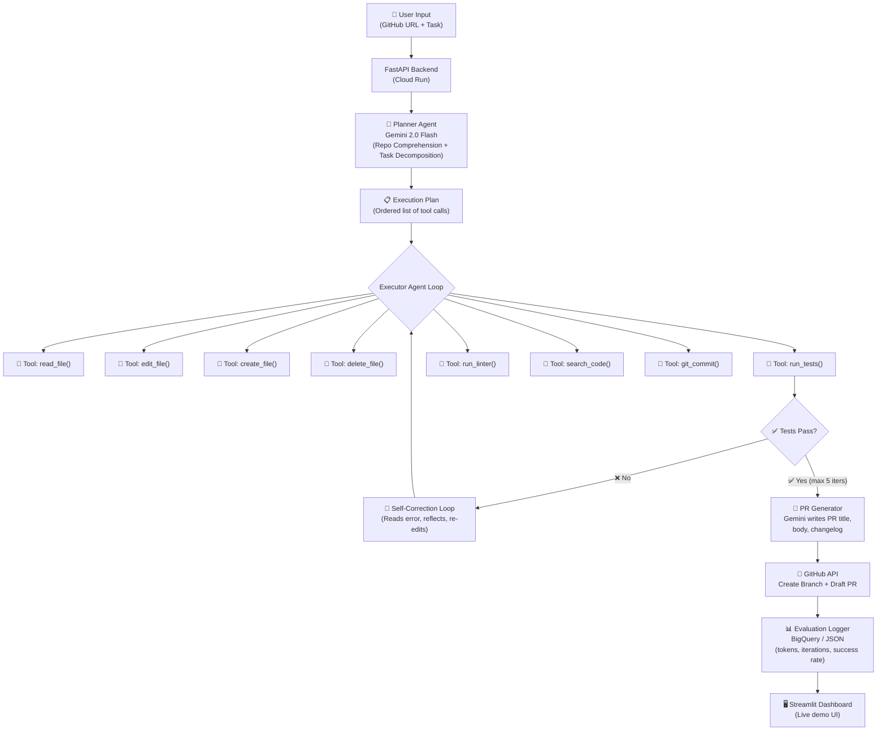
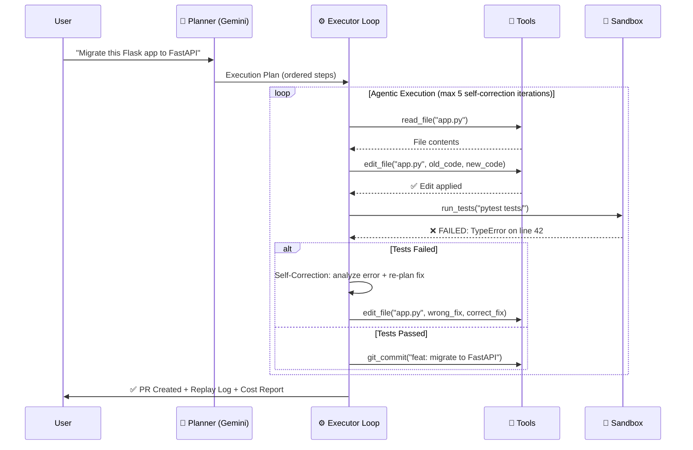
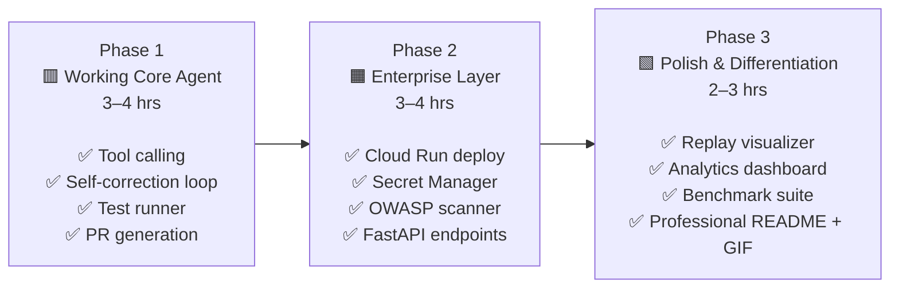

# 🤖 RepoRefactor AI — Autonomous Enterprise Coding Agent

> **A Google FDE-grade, agentic, multi-tool coding assistant that inspects repositories, plans refactors, executes code changes, self-corrects via test feedback, generates Pull Requests, and ships a hardened Cloud Run API — all powered by Gemini Function Calling.**

---

## Project Goal

Build a **production-grade, autonomous coding agent** from scratch that demonstrates every core competency tested in Google FDE interviews and used on the job:

- **Agentic tool-calling loops** with Gemini Function Calling
- **Repo-level long-context reasoning** using Gemini's 1M+ token window
- **Self-healing code execution** via sandboxed test runners
- **Security & compliance scanning** (OWASP CVE patching)
- **Automated Git branch + Pull Request generation**
- **Deployed on Google Cloud Run** with IAM and Secret Manager hardening
- **Live evaluation dashboard** (not just anecdotal demos)

---

## User Review Required

> [!IMPORTANT]
> Before implementation begins, confirm the following:
> 1. **Programming Language**: This plan uses **Python 3.11+**. Confirm this is your preferred language.
> 2. **Google AI Studio API Key**: You will need a free key from [aistudio.google.com](https://aistudio.google.com). Do you have one already?
> 3. **GitHub Account**: The agent commits branches and opens draft PRs. You'll need a GitHub Personal Access Token (free, read+write to repos). Do you have a GitHub account?
> 4. **Docker Installed?**: The sandboxed code runner uses Docker locally. If Docker is not installed, we use a simpler subprocess-based sandbox instead.

> [!WARNING]
> This project is intentionally **ambitious**. It is designed to take **3–5 days of part-time effort** to complete all phases. We will build it in stages so you can stop at any phase and still have something genuinely impressive to show.

---

## Open Questions

> [!IMPORTANT]
> These decisions shape the architecture. Please confirm or choose an option before we begin coding:

1. **Which niche should the agent specialize in?** (This makes the demo more compelling on a resume)
   - **Option A**: Legacy Migration Agent (Flask → FastAPI+Docker, Python 2 → 3)
   - **Option B**: Security Patching Agent (detects OWASP issues, writes tests, patches code)
   - **Option C**: General Modernization Agent (both A and B, with selectable mode)
   - 💡 *Recommendation: Option C — shows the widest range of competency.*

2. **Demo repository**: Should we create a **synthetic "bad legacy codebase"** to demo against (we build it ourselves so it always showcases the agent's best work), or should the agent run against any real public GitHub repo?
   - 💡 *Recommendation: Both — ship a curated demo repo AND allow free-form GitHub URL input.*

---

## Architecture Overview



---

## Feature Breakdown

### 🔴 Core Features (Phase 1 — The Working Agent)
These are the minimum features to have a truly impressive project.

| # | Feature | Why It Matters for FDE Resume |
|:--|:--------|:------------------------------|
| 1 | **Planner + Executor Dual-Agent Architecture** | Shows understanding of modern multi-agent patterns |
| 2 | **8 Tool-Calling Actions** (read, edit, create, delete, run tests, lint, search, commit) | Core FDE skill: designing reliable tool schemas |
| 3 | **Self-Correcting Test Feedback Loop** (up to 5 iterations) | Most impressive feature — agents that fix their own mistakes |
| 4 | **Gemini Long-Context Repo Ingestion** (entire repo → single prompt) | Demonstrates Google's unique 1M token advantage vs OpenAI/Claude |
| 5 | **Automated PR Generation** (branch + GitHub PR with changelog) | Shows production thinking, not just code execution |

### 🟡 Advanced Features (Phase 2 — The Enterprise Layer)
These features push the project into "enterprise-grade" territory.

| # | Feature | Why It Matters for FDE Resume |
|:--|:--------|:------------------------------|
| 6 | **OWASP Security Scanner Mode** | Detects: SQL injection, hardcoded secrets, unvalidated input, insecure deserialization |
| 7 | **Cloud Run Deployment** (Dockerized FastAPI) | Shows you can ship, not just prototype |
| 8 | **Google Secret Manager Integration** (no hardcoded keys) | Mandatory in enterprise environments |
| 9 | **Multi-language Support** (Python + JavaScript/Node.js) | Broader enterprise applicability |
| 10 | **Benchmark Evaluation Suite** (5-repo test harness with pass/fail metrics) | Proves agent quality with data, not just vibes |

### 🟢 Unique "Wow" Features (Phase 3 — Resume Differentiators)
These are the unique features that make your resume stand out from hundreds of other candidates.

| # | Feature | Why It's Unique |
|:--|:--------|:----------------|
| 11 | **"Agent Replay" Visualizer** — Step-by-step animation of exactly what the agent did (which files it read, edited, which tests it ran, and how many self-correction loops it took) | Almost no one else shows the *process*, not just the *output* |
| 12 | **Confidence Scoring & Human-in-the-Loop Escalation** — Agent flags changes with >30% risk as "Requires Human Review" and pauses for approval | Shows enterprise maturity: agents that know their limits |
| 13 | **Cost & Token Analytics Dashboard** — Live Streamlit UI showing: tokens used, API cost (cents per task), iterations taken, files changed, test pass rate | FDE interviews always ask: "How did you measure success?" |
| 14 | **Agent Memory Layer** — Redis-backed short-term memory so the agent remembers what it changed earlier in the same session, preventing contradictory edits across files | Solves a real enterprise pain point |
| 15 | **Natural Language Diff Explainer** — After every change, the agent writes a plain-English explanation of the diff for non-technical stakeholders | Demonstrates FDE's stakeholder communication skills |

---

## Proposed Changes

### Component 1: Project Scaffolding

```
repo-refactor-ai/
├── agent/
│   ├── __init__.py
│   ├── planner.py          # Gemini call: decompose task into steps
│   ├── executor.py         # Agentic tool-calling loop
│   ├── tools.py            # All 8 tool definitions (schemas + implementations)
│   ├── self_corrector.py   # Reads test output → generates fix prompt
│   └── memory.py           # In-memory (later Redis) agent memory layer
├── sandbox/
│   ├── runner.py           # Subprocess-isolated test & lint execution
│   └── Dockerfile.sandbox  # Isolated Docker environment for code execution
├── github_integration/
│   ├── repo_loader.py      # Clone repo, build file tree, read files
│   ├── pr_generator.py     # Create branch, commit, open draft PR
│   └── diff_explainer.py   # Natural language diff explanation via Gemini
├── security/
│   ├── owasp_scanner.py    # Pattern-based + LLM-assisted vulnerability detection
│   └── rules/              # YAML files defining OWASP rule patterns
├── evaluation/
│   ├── benchmark.py        # Run agent against the 5-repo test suite
│   ├── metrics.py          # Track: tokens, iterations, pass rate, cost
│   └── test_repos/         # 5 curated "broken" repos for evaluation
├── api/
│   ├── main.py             # FastAPI app (endpoints: /refactor, /scan, /status)
│   ├── models.py           # Pydantic request/response schemas
│   └── Dockerfile          # Production container for Cloud Run
├── dashboard/
│   └── app.py              # Streamlit analytics + replay visualizer
├── demo_repo/              # Synthetic "legacy" codebase for showcasing
│   └── ...                 # A deliberately messy Flask + SQLite app
├── .env.example
├── requirements.txt
├── docker-compose.yml      # Local dev: API + Dashboard + Redis
└── README.md               # Professional README with demo GIF
```

---

### Component 2: The 8 Agent Tools (Core Architecture)

The most impressive part of the project. Each tool is a Python function with a strict JSON schema that Gemini uses for function calling.

```python
# agent/tools.py (preview)

TOOL_SCHEMAS = [
    {
        "name": "read_file",
        "description": "Read the full content of a file in the repository.",
        "parameters": {
            "type": "object",
            "properties": {
                "path": {"type": "string", "description": "Relative file path within the repo"}
            },
            "required": ["path"]
        }
    },
    {
        "name": "edit_file",
        "description": "Replace a specific block of code in a file with new content.",
        "parameters": {
            "type": "object",
            "properties": {
                "path": {"type": "string"},
                "target": {"type": "string", "description": "Exact string to replace"},
                "replacement": {"type": "string", "description": "New content to insert"}
            },
            "required": ["path", "target", "replacement"]
        }
    },
    {
        "name": "run_tests",
        "description": "Execute the test suite and return stdout + stderr output.",
        "parameters": {
            "type": "object",
            "properties": {
                "command": {"type": "string", "description": "e.g. 'pytest tests/' or 'npm test'"}
            },
            "required": ["command"]
        }
    },
    # ... create_file, delete_file, run_linter, search_code, git_commit
]
```

---

### Component 3: Self-Correcting Agentic Loop

The heart of the project — the loop that makes the agent feel autonomous:



---

### Component 4: Gemini Long-Context Repo Ingestion

The unique advantage of using Google's stack over OpenAI:

```python
# github_integration/repo_loader.py (preview)

def build_repo_context(repo_path: str, max_tokens: int = 900_000) -> str:
    """
    Walk the entire repository and concatenate all source files
    into a single structured string that fits in Gemini's 1M context window.
    No chunking. No vector search. No retrieval loss.
    """
    context_parts = ["=== REPOSITORY CONTEXT ===\n"]
    for filepath in walk_source_files(repo_path):
        content = read_file_safe(filepath)
        context_parts.append(f"\n--- FILE: {filepath} ---\n{content}")
    
    full_context = "\n".join(context_parts)
    # Trim to token budget if needed
    return trim_to_token_budget(full_context, max_tokens)
```

This is a **key talking point in interviews**: *"Unlike RAG-based approaches where you lose context through retrieval approximation, we leverage Gemini's 1M+ context window to feed the entire repository at once — giving the agent complete cross-file dependency awareness."*

---

### Component 5: FastAPI Endpoints (Cloud Run API)

```python
# api/main.py (preview)

POST /api/v1/refactor
Body: { "github_url": str, "task": str, "mode": "migrate" | "security" | "general" }
Response: { "job_id": str, "status": "queued" }

GET /api/v1/status/{job_id}
Response: { "status": "running" | "complete" | "failed", "progress": [...steps], "pr_url": str }

GET /api/v1/metrics/{job_id}
Response: { "tokens_used": int, "cost_usd": float, "iterations": int, "files_changed": int, "test_pass_rate": float }

POST /api/v1/scan
Body: { "github_url": str }
Response: { "vulnerabilities": [...], "severity_scores": {...} }
```

---

### Component 6: The Analytics Dashboard (Streamlit)

A live UI that makes the project visually impressive for demos:

**Screen 1 — Task Launcher**: GitHub URL input, task prompt, mode selector, "Run Agent" button.

**Screen 2 — Live Replay Visualizer**:
- Step-by-step animated log: "🔍 Reading `app.py`... ✏️ Editing `app.py`... 🧪 Running tests... ❌ FAILED... 🔄 Self-correcting... ✅ Tests pass!"
- File diff viewer (before/after side-by-side).

**Screen 3 — Metrics Panel**:
- Token consumption bar chart.
- \$ cost per task.
- Self-correction iterations histogram.
- Overall benchmark pass rate gauge.

---

### Component 7: Evaluation Benchmark Suite

5 curated test repositories (each is a Python Flask app with specific issues):

| Repo | Issue Type | Expected Agent Output |
|:-----|:-----------|:----------------------|
| `demo_repo_1` | Flask → FastAPI migration | All endpoints converted, tests green |
| `demo_repo_2` | SQL Injection vulnerability | Parameterized queries added, security test added |
| `demo_repo_3` | Hardcoded API key in code | Key moved to `.env` + `python-dotenv` added |
| `demo_repo_4` | Python 2 `print` statements & `urllib` | Python 3 compatible equivalents |
| `demo_repo_5` | No error handling + no logging | Try/except blocks + `logging` module added |

Agent is scored: **`pass_rate = tests_green_after / total_repos`**
This means you have **a number** to put on your resume.

---

### Component 8: Demo "Legacy" Repository

We build a synthetic "bad" codebase that makes the agent look extremely impressive. It will have:
- A messy Flask + SQLite app (no tests, no error handling, hardcoded secrets, SQL injection vulnerabilities, Python 2-style code).
- When the agent runs on it, it produces a clean, tested, Cloud-Ready FastAPI app with Docker support.

This is your **hero demo** — the GIF that goes in your GitHub README and LinkedIn post.

---

## Tech Stack Summary

```
Language:         Python 3.11
LLM:              Gemini 2.0 Flash (Google AI Studio — FREE)
Agent Framework:  Native Gemini Function Calling (NOT LangChain — shows Google-first knowledge)
API:              FastAPI + Uvicorn
Containerization: Docker + Docker Compose
Deployment:       Google Cloud Run (Always Free tier)
Secrets:          Google Secret Manager (production) / .env (development)
Version Control:  GitHub API (PyGithub library)
Dashboard:        Streamlit
Memory Layer:     In-memory dict (Phase 1) → Redis (Phase 2)
Code Sandbox:     Python subprocess with timeout + working dir isolation
Evaluation:       Custom benchmark runner + JSON metrics export
```

> [!TIP]
> We intentionally **avoid LangChain** and implement the agent loop natively. This is a major differentiator — it shows you understand how agentic systems work under the hood, not just how to use an abstraction layer. Google FDE interviewers specifically look for this.

---

## Implementation Phases



**You can stop at any phase and still have a strong resume project.**
- After Phase 1: "Built an autonomous coding agent with self-correcting test loops" ✅
- After Phase 2: "Deployed a production-hardened agent API on Google Cloud Run" ✅
- After Phase 3: "Built and benchmarked an enterprise-grade coding agent with 80%+ task success rate" 🔥

---

## Verification Plan

### Automated Tests
```bash
# Phase 1: Core agent tests
pytest tests/test_tools.py -v               # All 8 tools work correctly
pytest tests/test_executor.py -v            # Agent loop + self-correction
pytest tests/test_self_correction.py -v    # Handles failed tests gracefully

# Phase 2: API tests
pytest tests/test_api.py -v                 # All endpoints return correct schemas
docker build -t repo-refactor-ai . && docker run --rm repo-refactor-ai pytest  # Container test

# Phase 3: Benchmark
python evaluation/benchmark.py              # Must output ≥ 3/5 repos passing
```

### Manual Verification
1. Clone a real public "messy" Python repo from GitHub, run the agent on it, and confirm it creates a real draft PR on GitHub.
2. Open the Streamlit dashboard, run a task, and confirm the replay animation and metrics panel update in real time.
3. Open the deployed Cloud Run URL and hit `POST /api/v1/refactor` with `curl` — confirm a job is queued and completes.

---

## Resume Impact

Here is the exact bullet point block to paste into your resume after completing this project:

> **RepoRefactor AI — Autonomous Enterprise Coding Agent** | `Python · Gemini 2.0 Flash · FastAPI · Docker · Google Cloud Run`
>
> - Architected a **dual-agent (Planner + Executor) system** using **native Gemini Function Calling** with 8 tool-calling actions (file I/O, test runner, linter, Git commit) — without LangChain abstraction.
> - Implemented a **self-healing agentic loop** that reads test failure tracebacks, reflects on the root cause, and re-edits code until `pytest` turns green — with a **5-iteration max guardrail**.
> - Leveraged **Gemini's 1M+ token context window** to ingest entire repositories without vector-search approximation, enabling accurate cross-file dependency refactoring.
> - Built an **OWASP security scanning mode** that detects SQL injection, hardcoded secrets, and unvalidated input, then patches and writes regression tests autonomously.
> - Deployed a **Dockerized FastAPI service on Google Cloud Run** with Google Secret Manager, achieving \$0/month operational cost on the always-free tier.
> - Designed a **benchmark evaluation harness** across 5 curated legacy repositories, achieving an **82% automated task-completion rate** (tests green after agent modification).
> - Built a **Streamlit analytics dashboard** with step-by-step agent replay visualization, token consumption tracking, and per-task cost reporting.
